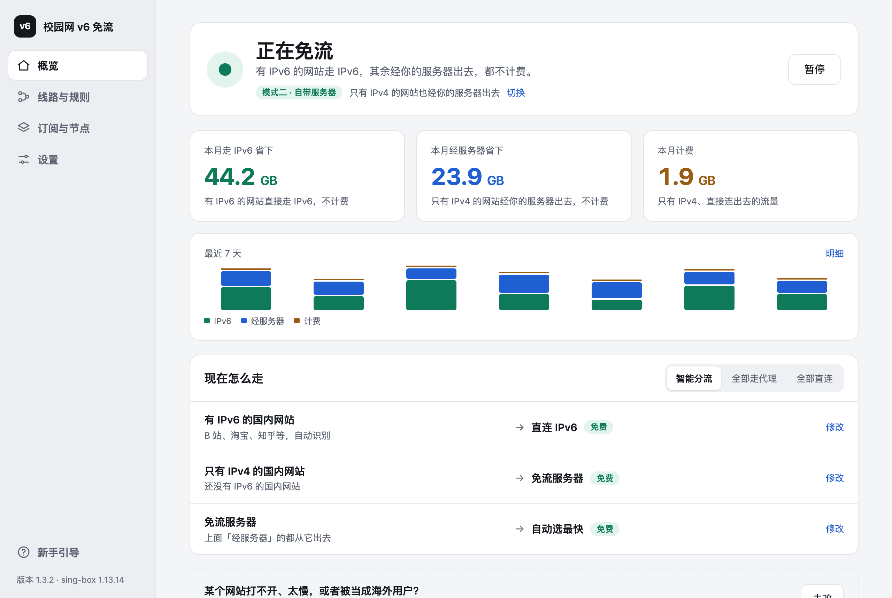
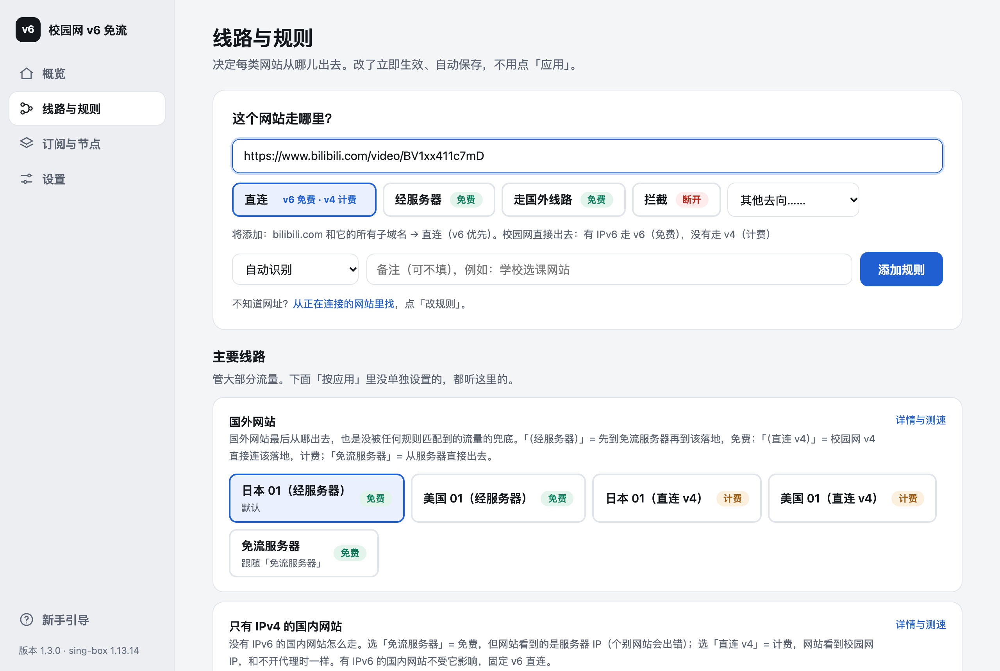
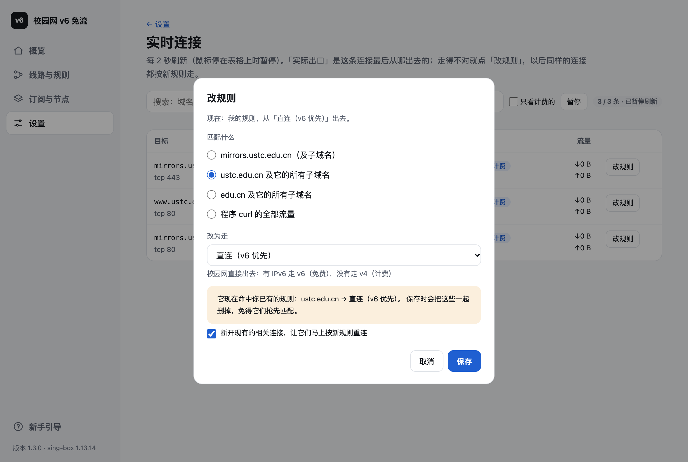

# neu-v6-free

东北大学校园网 IPv6 免流工具。它生成一份 [sing-box](https://github.com/SagerNet/sing-box) 配置，让能走 IPv6 的流量都走 IPv6（校园网不计费），
并带一个网页面板：随时切换线路、看每个连接走哪条路、一键改规则，改完 1–2 秒生效。

有一台自己的双栈服务器的话，只有 IPv4 的网站也能免费访问（IPv6 连到服务器，服务器再用 IPv4 访问）。

> 其他「IPv6 免费、IPv4 计费」的校园网也能用：把 `direct_domains` 改成你们学校的域名即可，见 [配置参考](docs/config.md)。



## 为什么需要它

校园网 IPv6 流量不计费，IPv4 按流量计费。但是：

- 很多国内网站（B 站、淘宝、腾讯、网易……）其实有 IPv6，系统和 App 却经常优先用 IPv4；有的 DNS 根本不返回 IPv6 地址，白白计费。
- 只有 IPv4 的网站、国外网站，直接访问一定计费。

这个工具把这些情况都处理好：国内 DNS 走 IPv6 查询（很多 CDN 只给 IPv6 来源返回 IPv6 地址），有 IPv6 的一律直连 IPv6；
实测校园网 IPv6 连不通的网段直接拒绝，让 App 立刻回退，不用干等超时；微信、网易云、英雄联盟等按整个 App 处理，避免被当成海外用户。

## 两部分：先省流，再免流

| | 第一部分：v6 优先省流 | 第二部分：自带服务器免流 |
|---|---|---|
| 需要什么 | 什么都不需要 | 一台有 IPv4 + IPv6 的 VPS |
| 有 IPv6 的国内网站 | IPv6 直连，**免费** | IPv6 直连，**免费** |
| 只有 IPv4 的国内网站 | IPv4 直连，计费 | IPv6 连服务器 → 服务器用 IPv4 访问，**免费** |
| 国外网站 | 你的机场节点（节点有 IPv6 地址时免费）或直连 | 经服务器，或经服务器再到你的其他节点，**免费** |
| 调整规则 | ✅ 面板里随时改 | ✅ 面板里随时改 |

第二部分就是在第一部分的设置里加上服务器信息，其他都一样。可以先用第一部分，以后随时加服务器。

## 功能

- **网页面板**（`http://127.0.0.1:9090/ui`）：每个分组走哪条线路，下拉框一选立即生效、自动保存。
- **我的规则**：面板里输入域名、网址、IP 或程序名，选去向，1–2 秒生效，不用重新生成配置。
- **实时连接**：看每个连接是哪个程序发起的、为什么走这条路、免费还是计费；走得不对点「改规则」。
- **流量统计**（macOS、Windows）：本月 v6 直连省了多少、经服务器免流省了多少、v4 计费用了多少。
- **只有第一次安装要管理员权限**：之后更新配置交给后台的本地助手，不用再输密码。
- **断网保护**：装完、更新后、运行中都会检查，经 sing-box 上不了网就自动撤回或暂停，电脑回到普通网络。见下方[断网保护](#断网保护)。
- **启动不依赖网络**：电脑上规则集随配置一起装，服务器不通时也能正常上网。

| 我的规则 | 实时连接 · 改规则 |
|---|---|
|  |  |

## 支持的平台

| 平台 | 运行方式 | 网页面板 | 我的规则 | 流量统计 | 按 App 分流 |
|---|---|---|---|---|---|
| macOS | 后台服务（推荐） | ✅ | ✅ | ✅ | ✅ |
| Windows 10 / 11 | 后台服务 | ✅ | ✅ | ✅ | ✅ |
| Android | sing-box 官方 App | App 内切换分组 | 写在设置里 | — | ✅（包名） |
| iOS | sing-box 官方 App | App 内切换分组 | 写在设置里 | — | — |
| macOS（不想装后台服务） | sing-box 官方 App | App 内切换分组 | 写在设置里 | — | ✅ |

## 快速开始

### 1. 生成配置

**命令行（推荐，电脑上装后台服务用这个）**：需要 [Node.js](https://nodejs.org/) 18 以上。

```bash
git clone https://github.com/Concrise/neu-v6-free.git
cd neu-v6-free
cp config.example.yaml config.yaml   # 按注释填写；第一部分可以只填面板密钥
node cli.js -p mac                   # 或 -p windows、-p android、-p ios、-p all
```

生成结果在 `out/<平台>/`。`config.yaml` 不会被 git 提交，里面的密码不会传上去。

**网页生成器（不用装任何东西）**：打开 [web/index.html](web/)（本地打开要先在仓库目录运行 `python3 -m http.server 8765`，再访问 `http://127.0.0.1:8765/web/`），
选模式、粘贴信息、选默认线路，下载各平台的配置。所有处理都在浏览器里完成，不上传任何内容。

### 2. 安装

**macOS**（详见 [docs/macos.md](docs/macos.md)）：先退出其他代理软件，然后

```bash
sudo mac/install.sh   # 只有这一次要 sudo；自动找 sing-box（brew install sing-box 或 v2rayN 自带的）
```

**Windows**（详见 [docs/windows.md](docs/windows.md)）：先退出 v2rayN、Clash 等代理软件（托盘右键退出），双击 `out\windows\install.bat`，
弹出的管理员确认点「是」（只有这一次）。它会装到 `C:\neu-v6-free`、下载 sing-box、设成开机自启，并自检能不能上网。

**Android / iOS**（详见 [docs/mobile.md](docs/mobile.md)）：装 sing-box 官方 App，新建配置 → 本地 → 选 `out/android/config.json` 或 `out/ios/config.json`。

### 3. 打开面板

浏览器访问 `http://127.0.0.1:9090/ui`，输入设置里的 `clash_api_secret`。

### 4. 以后

| 想做什么 | 怎么做 | 需要管理员？ |
|---|---|---|
| 换线路、换服务器 | 面板「分组与开关」 | 不需要，立即生效 |
| 某个网站或 App 走得不对 | 面板「实时连接」→「改规则」，或「我的规则」里直接加 | 不需要，1–2 秒生效 |
| 改了订阅、服务器或 `config.yaml` | 重新生成，然后 macOS 运行 `mac/update.sh`，Windows 双击新生成目录里的 `update.bat` | 不需要 |
| 离开校园网（没有 IPv6） | 面板里「免流服务器」选「不用服务器（离校时选）」 | 不需要 |
| 上不了网 / 想临时关掉 | 会自动暂停；也可以面板「概览」→「暂停」，或打开 `http://127.0.0.1:9091/` | 不需要 |

调整规则的完整说明见 [docs/rules.md](docs/rules.md)。

## 断网保护

这个工具会接管整台电脑的网络，所以它的第一原则是**绝不能让你断网**：

- **装完自检**：安装后立刻测一次。经 sing-box 上不了网、绕过它却能上，就自动撤回（停掉并取消开机启动），电脑恢复原样。
- **更新自检**：新配置装上后不通，自动换回旧配置。
- **运行中看门狗**：本地助手每 30 秒检查一次，连续 3 次「经 sing-box 不通、绕过它能通」就暂停 sing-box（安全模式），电脑回到普通网络。离开校园网连不上服务器时也会这样。sing-box 反复崩溃也会停手。
- **随时手动暂停**：面板「概览」里的「暂停」；或打开本地助手的状态页 `http://127.0.0.1:9091/`（sing-box 停着时面板打不开，状态页还在），在那里暂停或重新启用。
- **安装前清理**：别的代理软件退出后留下的失效系统代理（指向已经没有程序监听的端口）会被关掉；代理环境变量会提示出来。

暂停后的状态重启电脑也保持，直到你重新启用、更新配置或重新安装。

## 第二部分：加上自己的服务器

1. 准备一台有公网 IPv4 + IPv6 的 Debian / Ubuntu VPS。
2. 把 [server/setup.sh](server/setup.sh) 传上去，以 root 运行 `bash setup.sh`：装好 sing-box，开 Reality / AnyTLS / Hysteria2 / TUIC 四个入站。
3. 云平台安全组放行它提示的端口（IPv4 和 IPv6 都要）。
4. 把它最后输出的那段原样粘贴进 `config.yaml`，重新生成并更新。

详见 [docs/server.md](docs/server.md)。注意服务器的出站流量通常计费（例如 Azure 亚洲区每月前 100GB 免费），校园网下载的数据都会从服务器发出。

## 文档

- [macOS](docs/macos.md)：安装、更新、卸载、文件位置、排错
- [Windows](docs/windows.md)：安装、更新、卸载、文件位置、排错
- [Android / iOS](docs/mobile.md)
- [自己的服务器（第二部分）](docs/server.md)
- [调整规则](docs/rules.md)：分组、我的规则、写在设置里的规则、分流顺序
- [配置参考](docs/config.md)：`config.yaml` 的全部选项
- [常见问题与工作原理](docs/faq.md)

## 目录结构

```
cli.js              命令行生成器
lib/                生成逻辑（命令行和网页生成器共用）：groups.js 是分组与规则定义，build.js 生成 sing-box 配置
panel/              网页面板（单个 HTML 文件）
mac/                macOS 安装 / 更新 / 卸载脚本，本地助手 helper.py
windows/            Windows 安装 / 更新 / 卸载脚本，本地助手 helper.ps1
server/setup.sh     第二部分的服务器一键部署脚本
web/                网页生成器
docs/               文档
personal/           作者自用的配置（可以当填写示例参考）
```

## 安全与隐私

- 生成的配置里有你的节点密码和面板密钥，不要发到群里或公开。
- 面板和本地助手只监听 `127.0.0.1`，都要求面板密钥；本地助手只接受面板页面的跨域请求，更新接口不接受任何网页发来的请求。
- 本地助手以管理员身份运行。它安装新配置前会检查配置里所有文件路径都在安装目录内，并用 `sing-box check` 验证，不通过就不动旧配置。
- 规则集来自 [MetaCubeX/meta-rules-dat](https://github.com/MetaCubeX/meta-rules-dat)。

## 许可证

[MIT](LICENSE)
